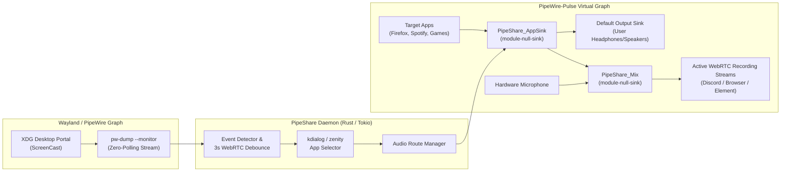

# PipeShare

[](https://github.com/SavasTanriverdi/PipeShare/actions/workflows/rust.yml)
[](https://github.com/SavasTanriverdi/PipeShare/releases)
[](LICENSE)
[](#supported-environments)

**Seamless, event-driven application audio routing for Linux/Wayland screen sharing sessions.**

On Linux/Wayland, sharing your screen in WebRTC and desktop communication apps (Discord, Element, Google Meet, Zoom, Slack, Firefox, Chromium) often captures video via `xdg-desktop-portal` without routing per-application audio. **PipeShare** runs as a lightweight, zero-polling background daemon that detects `ScreenCast` streams in real time, prompts you to select which applications to broadcast, mixes their audio with your microphone, and automatically cleans up when sharing ends.

---

## Architecture



## Key Features

- **Zero-Polling Event Detection (~0% Idle CPU):** Streams PipeWire graph mutations via `pw-dump --monitor` and wakes only when a `Stream/Input/Video` or `Stream/Output/Video` ScreenCast node is created or destroyed.
- **WebRTC Reconnect Debouncing:** Handles rapid stream renegotiations (e.g., switching shared windows or WebRTC ICE restarts within 3 seconds) without dropping the virtual audio graph or re-prompting.
- **Safe Teardown Ordering:** Restores active recording `source-outputs` back to the hardware microphone *before* unloading virtual sinks, preventing WebRTC audio pipeline hangs on subsequent shares.
- **Multi-Compositor Support:** Automatically verifies `xdg-desktop-portal` and ScreenCast backends across **KDE Plasma**, **GNOME**, **Hyprland**, **Sway / wlroots**, and **GTK** environments.
- **Headless / Status Bar Friendly:** Supports `pipeshare list --json` for integration with Waybar, Polybar, Eww, and automation scripts.

## Supported Environments

| Desktop / Compositor | Portal Backend | Dialog Utility |
|----------------------|----------------|----------------|
| **KDE Plasma (Wayland)** | `xdg-desktop-portal-kde` | `kdialog` |
| **GNOME (Wayland)** | `xdg-desktop-portal-gnome` | `zenity` |
| **Hyprland** | `xdg-desktop-portal-hyprland` | `kdialog` / `zenity` |
| **Sway / wlroots** | `xdg-desktop-portal-wlr` | `zenity` / `kdialog` |

## Prerequisites

- Linux with **Wayland**
- **PipeWire** (`pipewire`, `pipewire-pulse`, `wireplumber`, `pw-dump`, `pw-link`)
- **PulseAudio utilities** (`pactl` via `pulseaudio-utils` / `libpulse`)
- **XDG Desktop Portal** (`xdg-desktop-portal` + compositor backend)
- **Dialog prompt utility:** `kdialog` (KDE) or `zenity` (GNOME/WL)

## Installation

### Build from Source

```bash
git clone https://github.com/SavasTanriverdi/PipeShare.git
cd PipeShare
cargo build --release
sudo install -Dm755 target/release/pipeshare /usr/local/bin/pipeshare
```

### Enable Systemd User Service (Recommended)

```bash
mkdir -p ~/.config/systemd/user/
cp pipeshare.service ~/.config/systemd/user/
systemctl --user daemon-reload
systemctl --user enable --now pipeshare.service
```

## CLI Usage

| Command | Description |
|---------|-------------|
| `pipeshare daemon` | Start the event-driven background service |
| `pipeshare list [--json]` | List active audio-producing applications (table or JSON array) |
| `pipeshare route <app>` | Manually route a specific application's audio into the virtual mic mix |
| `pipeshare stop` | Force-unload all active PipeShare virtual sinks and restore default mic |
| `pipeshare status` | Inspect PipeWire, WirePlumber, XDG Portal, and active session status |
| `pipeshare monitor` | Stream live ScreenCast start/stop events from the PipeWire graph |
| `pipeshare version` | Print `pipeshare` version |

## Security

See [SECURITY.md](SECURITY.md) for details on PipeShare's IPC trust boundaries, subprocess argument validation, and vulnerability reporting instructions.

## Contributing

Contributions, bug reports, and compositor compatibility feedback are welcome! Please read [CONTRIBUTING.md](CONTRIBUTING.md) before submitting a pull request.

## License

Distributed under the [MIT License](LICENSE).
